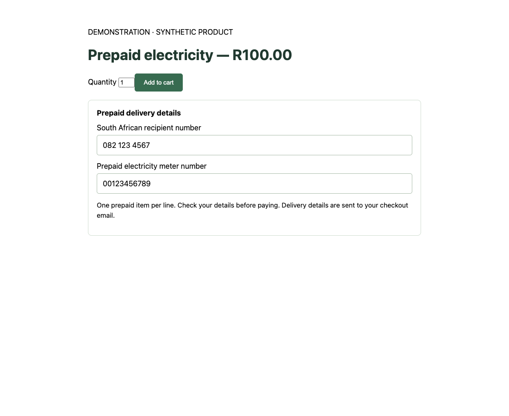

# SIMcloud for Shopify — prepaid product fields

Open-source Shopify theme app extension for South African airtime, mobile data, VAS vouchers and prepaid electricity. It collects the recipient and meter details required for prepaid delivery through SIMcloud.

**Development alpha. This extension is not approved or listed on the Shopify App Store.** The hosted SIMcloud service handles merchant authorization, catalogue imports and order fulfilment separately. That server application is private and is not included in this repository.



## What this extension does

- Shows recipient fields for airtime, mobile data and electricity products.
- Shows a meter-number field for prepaid electricity.
- Adds those details to the Shopify cart as line-item properties.
- Restricts prepaid product quantities to one and validates the recipient before adding to cart.
- Supports Shopify product templates through a theme app block.

The extension does not contain API credentials, a wallet, payment processing, a purchase endpoint or the hosted fulfilment implementation. Shopify checkout handles customer payment. The private service separately verifies payment and processes eligible orders through the SIMcloud API.

## Merchant installation

This source ZIP is for extension development; it is not a standalone merchant installation package. Merchants install the SIMcloud Shopify app when an approved installation is available, then add the **SIMcloud prepaid details** block in the product template. Follow the [merchant guide](docs/merchant-guide.md).

## Contributor setup

Use Node.js and Shopify CLI for the Liquid theme extension. Start with the [development guide](docs/development.md). The app configuration contains example values only. Contributors must provide their own private development app configuration and use test stores.

```sh
npm ci
npx playwright install chromium
npm test
python3 scripts/public_check.py
python3 scripts/package.py
```

The browser checks use synthetic forms. They do not contact SIMcloud or spend wallet funds. See [testing](docs/testing.md).

## Repository boundary

This public repository contains Shopify extension code, synthetic examples, documentation and extension checks. Server applications, deployment adapters, infrastructure configuration, private account bindings, logs, databases, operational evidence and credentials belong in private repositories or private storage. The release allowlist and public-source guard enforce this boundary.

## License and support

Licensed under GPL-2.0-or-later. SIMcloud and Shopify names remain subject to their owners' rights. This project is not endorsed by Shopify. Use GitHub Issues for reproducible extension bugs. Follow [SECURITY.md](SECURITY.md) for sensitive reports; never include credentials or customer details in an issue.
